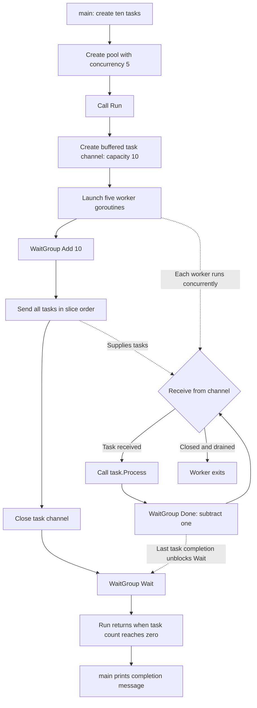

# Understanding the worker pool

This program processes ten tasks using five worker goroutines. A channel distributes tasks to available workers, and a `sync.WaitGroup` makes `main()` wait until every task has finished.

## 1. The task contract

```go
type Task interface {
    Process()
}
```

A `Task` is anything with a `Process()` method. The pool calls this method without needing to know the concrete task type.

This example has two implementations:

| Task | What `Process()` does | Simulated duration |
| --- | --- | --- |
| `*EmailTask` | Prints the recipient, then sleeps | 2 seconds |
| `*ImageProcessingTask` | Prints the image path, then sleeps | 5 seconds |

Both methods use pointer receivers, so `main.go` puts pointers such as `&EmailTask{...}` into the `[]Task` slice. No real email is sent and no image is changed. `Subject` and `MessageBody` are stored but not used by the current implementation.

## 2. `main()` prepares the work

`main.go` creates ten tasks in alternating order: email 1, image 1, email 2, image 2, and so on through email 5 and image 5.

It then creates:

```go
wp := WorkerPool{
    Tasks:       tasks,
    concurrency: 5,
}
```

The pool fields have these responsibilities:

| Field | Purpose |
| --- | --- |
| `Tasks []Task` | Holds all the work to submit |
| `concurrency int` | Determines how many worker goroutines `Run()` starts |
| `tasksChan chan Task` | Shares the pending tasks between workers |
| `wg sync.WaitGroup` | Counts tasks that have not finished yet |

`main()` calls `wp.Run()` synchronously. It cannot print the final completion message until `Run()` returns.

## 3. `Run()` sets up and submits the work

### Create the channel

```go
wp.tasksChan = make(chan Task, len(wp.Tasks))
```

The channel has capacity ten, matching the number of tasks. It can hold all submitted tasks even if no worker has received one yet. Workers may also receive tasks while submission is happening.

### Start five workers

```go
for i := 0; i < wp.concurrency; i++ {
    fmt.Printf("\n====loop %d \n", i)
    go wp.worker()
}
```

Each `go wp.worker()` starts a goroutine. All five workers read from the same channel. A task is received by one worker; it is not broadcast to every worker.

The `====loop` messages are printed by `Run()` as it launches workers. They are launch-loop counters, not worker IDs attached to individual tasks. Task output can interleave with these messages.

### Register and enqueue every task

```go
wp.wg.Add(len(wp.Tasks))
for _, task := range wp.Tasks {
    wp.tasksChan <- task
}
close(wp.tasksChan)
```

`Add(10)` sets the unfinished-task count to ten before any task is sent. This ensures a worker cannot finish a submitted task and call `Done()` before the task has been counted.

The loop sends tasks in slice order. Closing the channel means that no more tasks will be sent. It does **not** discard queued tasks or cancel tasks already running: workers can continue receiving buffered tasks until the channel is drained.

## 4. Each worker processes tasks repeatedly

```go
func (wp *WorkerPool) worker() {
    for task := range wp.tasksChan {
        task.Process()
        wp.wg.Done()
    }
}
```

Each worker follows this cycle:

1. Receive one task from the shared channel. If the channel is open and empty, wait for a task.
2. Call that task's concrete `Process()` method.
3. After `Process()` returns, call `Done()` to subtract one from the unfinished-task count.
4. Receive another task, or exit the loop once the channel is closed and drained.

A worker handles one task at a time. With five workers, at most five `Process()` calls run concurrently. Workers are reused; the program does not start a new goroutine for every task.

## 5. Wait for completion and return to `main()`

```go
wp.wg.Wait()
```

`Wait()` blocks until the task count reaches zero. After the five workers have collectively called `Done()` for all ten tasks, `Run()` returns and `main()` prints:

```text
All tasks have been processed!
```

The WaitGroup counts **tasks**, not worker goroutines. It guarantees that all `Process()` calls have returned before the final message; it does not explicitly wait for each worker goroutine to return from its loop. Closing and draining the channel lets those loops terminate naturally.

## Flow diagram



## Ordering and timing

Tasks are enqueued in order, but worker assignment, printed output, and completion order depend on goroutine scheduling. A worker finishing a short email task can take another task while other workers are still processing images. There is no barrier between groups of five tasks.

Sequential processing would take approximately `5 × 2 + 5 × 5 = 35 seconds`. Five workers overlap those sleeps, so execution is much faster. One possible schedule, ignoring overhead, is:

| Time | Possible activity |
| --- | --- |
| 0 seconds | Start email 1, image 1, email 2, image 2, email 3 |
| 2 seconds | The three email workers take image 3, email 4, and image 4 |
| 4 seconds | The worker finishing email 4 takes email 5 |
| 5 seconds | The workers running images 1 and 2 finish; one takes image 5 |
| 6 seconds | Email 5 finishes |
| 7 seconds | Images 3 and 4 finish |
| 10 seconds | Image 5 finishes; `Wait()` can return |

This is an illustrative schedule, not a guaranteed runtime or output order. The task messages are printed **before** their sleeps, so a printed task message means processing has started, not finished.

## Current implementation limits

- With tasks present, `concurrency` must be positive. With zero or negative workers, tasks stay queued and `Wait()` blocks forever.
- `Process()` returns no error, so the pool has no error reporting, retry, or cancellation mechanism.
- An unrecovered panic in a task terminates the program; the subsequent `Done()` is not executed.
- The channel buffer grows with the total task count. A large workload therefore allocates a large queue.
- The pool has shared mutable fields and is not designed for concurrent calls to `Run()` on the same instance.

The central idea is: **the channel distributes work, the workers execute it, and the WaitGroup tracks when all tasks are finished.**
